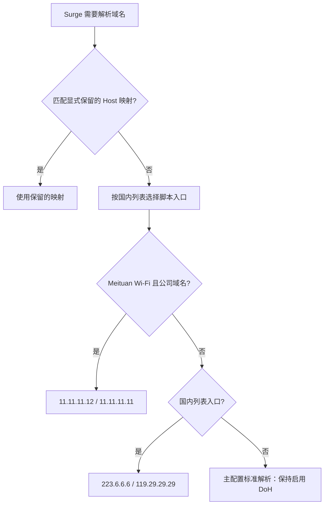

# Surge 配置

## DNS Routing（推荐）

[安装模块](https://raw.githubusercontent.com/afsfge/surge/main/DNS-Routing.sgmodule)。启用 `DNS Routing`，停用两个旧版 DNS 模块，保持 Scripting 开启，并保留主配置的默认 DoH。

- [force_doh.list](force_doh.list) 中的所有域名优先使用 `https://j16nfj6elr.cloudflare-gateway.com/dns-query`，不走 JS；初始为空，由你自行添加。它优先于下列所有规则，即使域名也在公司列表中。
- 只有 `sankuai.com`、`51ping.com` 根域名及子域名进入 JSC 脚本：`Meituan` Wi-Fi 使用内网 DNS；其他网络直接使用 `223.6.6.6 / 119.29.29.29`，不再按国内列表选择 DoH。
- Apple、iCloud、微信、腾讯五条特例直接使用 `119.29.29.29`。
- 国内 `direct.txt` 列表直接使用国内 DNS。
- 没有 `*` 脚本兜底；其余域名继续检查主配置的 Host 映射，未匹配时使用默认 DoH。

维护强制 DoH 域名时，在 `force_doh.list` 添加 `DOMAIN-SUFFIX,example.com`（根域名及子域名）或 `DOMAIN,host.example.com`（单域名），不加策略列。提交后更新 Surge 对应远程规则集，必要时清理 DNS 缓存。仓库已有的 `doh.list` 保持独立，新模块不引用它。

旧的 `Meituan-DNS-V2.sgmodule` 订阅地址同步提供同一新版内容，已有远程订阅可直接更新；本地安装需重新导入新版。两个地址只安装、启用其中一个，避免重复加载。模块不改变主配置的 `encrypted-dns-follow-outbound-mode`，保留原来的 `true` 即可。指定 DoH 仅约束 Surge 本地解析，不控制代理服务器远端解析或应用内置 DNS。

增加公司域名时，只需修改 `meituan_dns.list`：添加 `DOMAIN-SUFFIX,example.com` 覆盖根域名及子域名，或 `DOMAIN,host.example.com` 精确匹配。V2 模块与原生并发方案共用该列表，模块及 JS 无需修改。更新后刷新 Surge 中对应远程规则集。V1 文件保留供回退。当前 `sthree-itsec.meituan.com` 不在清单中。

```text
force_doh.list → 指定 Cloudflare Gateway DoH（最高优先级）
未命中且属于公司域名 → JS 判断 Wi-Fi → 内网 DNS / 国内 DNS
其余域名 → 原生 Host 规则 → 特例 DNS / 国内 DNS / 默认 DoH
```

主配置若另有固定 DNS 映射仍会生效；不要同时启用旧模块的 `*` 脚本规则。缓存命中不重新判断 Wi-Fi，切网后若沿用旧结果需清理 DNS 缓存。有线公司网络或仅 VPN 连接不会被视作 Meituan Wi-Fi。此优化减少脚本执行范围，不保证改善上游 DNS 或代理链路延迟。

运行 `node tests/meituan-dns-v2.test.cjs` 验证网络分支及模块规则结构。


## Meituan DNS 精简版

一个始终启用的模块和一个 DNS 脚本：仅当 SSID 严格等于 `Meituan`，且域名属于公司列表时，使用内网 DNS。没有模块自动启停、网络事件脚本或外部进程。

- [模块订阅地址](https://raw.githubusercontent.com/afsfge/surge/main/Meituan-DNS-Simple.sgmodule)
- [JavaScript 脚本](scripts/meituan-dns-simple.js)
- 公司域名：`sankuai.com`、`51ping.com`，包含根域名及其子域名。
- 国内列表：Loyalsoldier `direct.txt`，与本仓库用于流量分流的 `my_direct.list` 不同。



两个脚本入口执行同一个 JS，通过 `argument` 区分是否命中国内列表；公司域名判断优先于国内列表。SSID 不可用、空值、大小写不匹配或没有 Wi-Fi 时，均不使用公司 DNS。

### 安装

1. 备份当前主配置。在 Surge 模块管理中通过上面的模块订阅地址安装，脚本由模块的远程 URL 加载。
2. 主配置保持原来的 `encrypted-dns-server`（DoH），以及 `dns-server = 223.6.6.6,119.29.29.29`。模块不包含个人 DoH 地址或凭据。
3. 删除主配置中无条件使用公司 DNS 的 `*.sankuai.com`、`*.51ping.com` 映射，以及 `[SSID Setting]` 下的 `SSID:Meituan dns-server="11.11.11.12"`。否则停用模块后，旧的内网 DNS 设置仍然生效。
4. 开启 Scripting 并启用 `Meituan DNS 精简版`。不要同时启用之前的 DNS 自动切换模块；开启 Scripting 前确认其他脚本的启用状态。
5. 重新加载配置，刷新模块和远程脚本资源，并清理 Surge DNS 缓存。确认资源下载成功后再验证解析。

此模块的 `*` 会接管后续 Host 匹配。主配置原有 Apple、微信、腾讯等 DNS 特例将改为按国内列表/默认 DNS 处理。固定 IP、别名、Tailscale 特殊名称和 `/etc/hosts` 中必须保留的条目，需要显式放在本模块的两条脚本入口之前；模块目前仅保留 `*.local = server:system`。仓库既有 `meituan.sgmodule` 中的 `ntp.nasa.gov` 别名如仍需使用，也应在脚本入口前保留，不能依赖多个模块的加载顺序。

### 维护

公司域名只需修改 `scripts/meituan-dns-simple.js` 中的 `companyDomains` 数组。每项填写不带 `*.` 的域名后缀。修改并推送后，在 Surge 中更新远程脚本资源；仅更新模块不保证清除脚本缓存。若改名或换分支，需同步修改模块中的两个 `script-path`。

### 验证与边界

离线测试（无需 npm 依赖）：

```sh
node tests/meituan-dns-simple.test.cjs
```

测试覆盖公司/非公司网络、SSID 缺失、两个域名入口、公司根域名和子域名、大小写与末尾点、相似后缀及异常输入。测试使用模拟 Surge 全局变量，不能替代实际网络验收。

安装后连接 `Meituan`、切换手机热点、再切回公司 Wi-Fi，每次清理 DNS 缓存，使用 Surge DNS 查询/跟踪核对以下结果：

| 网络 | 公司域名 | 非公司且命中国内列表 | 非公司且未命中国内列表 |
| --- | --- | --- | --- |
| Meituan | 内网 DNS | 国内 DNS | 默认 DoH |
| 其他或 SSID 不可用 | 按国内列表或默认 DoH | 国内 DNS | 默认 DoH |

脚本仅在 Surge 实际执行解析时判断网络，缓存命中不会重新执行脚本，因此不保证网络切换瞬间更新所有缓存。未添加自动清缓存事件；切换网络后若沿用旧结果，应手动清理缓存。公司 DNS 故障时不主动改用公网 DNS，以免把内网域名错误解析到公网。

模块只影响 Surge 处理的本地 DNS，不改变流量出口，也不接管代理服务器远端解析、应用内置 DoH 或绕过 Surge 的系统查询。公司域名的流量仍需在现有规则中正确直连。仅连接公司有线网络或 VPN 而 SSID 不是 `Meituan` 时，不会启用内网 DNS。

停用模块可退出这套 DNS 脚本逻辑；如需完全恢复安装前行为，恢复备份的主配置并清理 DNS 缓存。

接口依据：[DNS Script](https://manual.nssurge.com/scripting/dns.html)、[Host 匹配规则](https://manual.nssurge.com/dns/local-dns-mapping.html)、[脚本全局变量](https://manual.nssurge.com/scripting/api.html)。配置语法在 Surge Mac 6.10.0 上验证；其他版本应先进行配置检查。

### iPhone 与 Apple TV

模块不再设置 `#!system=mac` 平台限制，iPhone 与 Apple TV 请使用同一个模块订阅 URL（raw.githubusercontent.com 原始文件地址，而不是 GitHub 文件网页）。Surge tvOS 与 iOS 使用相同内核，支持脚本；通过 iPhone 的 Surge tvOS 管理入口配置 Apple TV。

手机及 Apple TV 同样需要启用脚本，主配置保留 DoH。内网 DNS 仍严格依赖 SSID 等于 `Meituan`；家庭 Wi-Fi、有线网络或无法读取 SSID 时，只走国内列表/默认 DNS。不会因为运行在 Apple TV 上就启用公司 DNS。

目前仅在 Mac 6.10.0 上完成配置和解析实测，尚未在 iOS/tvOS 上验收。官方 iOS 更新日志确认从 5.14.3 开始支持 Host 中的 RULE-SET/DOMAIN-SET；多 DNS 服务器语法的文档版本门槛为 iOS 5.21.0+，建议使用最新版本。若导入仍提示无效，请提供 Surge 版本及具体错误信息，以区分平台限制、语法支持或下载内容问题。

参考：[模块平台限制](https://manual.nssurge.com/profile/module.html)、[Surge tvOS](https://kb.nssurge.com/surge-knowledge-base/guidelines/tvos)。

版本依据：[Surge iOS 更新日志](https://kb.nssurge.com/surge-knowledge-base/release-notes/surge-ios)。

### 高频域名直接解析

`*.apple.com.cn`、`*.icloud.com`、`*.weixin.com`、`*.tencent.com`、`*.apple.com` 在脚本入口之前固定使用 `119.29.29.29`，不执行 DNS 脚本，也不区分内外网。上述通配符不包含根域名，根域名继续按国内列表/默认 DNS 处理。两个 DNS 脚本显式使用 `engine=jsc`。

## 原生并发 DNS 方案

公司 DNS 清单独立维护在 [meituan_dns.list](meituan_dns.list)。添加 `DOMAIN-SUFFIX,example.com` 覆盖根域名和全部子域名，或 `DOMAIN,host.example.com` 精确匹配单个域名。不填写策略列。

在主配置 `[Host]` 中，将公司清单放在国内列表之前：

```ini
[Host]
*.local = server:system
RULE-SET:https://raw.githubusercontent.com/afsfge/surge/main/meituan_dns.list = server:11.11.11.12,11.11.11.11,223.6.6.6,119.29.29.29
*.apple.com.cn = server:119.29.29.29
*.icloud.com = server:119.29.29.29
*.weixin.com = server:119.29.29.29
*.tencent.com = server:119.29.29.29
*.apple.com = server:119.29.29.29
RULE-SET:https://raw.githubusercontent.com/Loyalsoldier/surge-rules/release/ruleset/direct.txt = server:223.6.6.6,119.29.29.29
```

使用时停用 DNS V2 和旧版 DNS 模块，保留原有默认 DoH。未匹配 Host 的域名使用默认解析。列表更新后刷新 Surge 对应远程规则集。

本方案无 JS、无网络判断：多个 DNS 并发竞争，公司网络下也可能采用公网答案；列表中出现内外网结果不同的域名时，可能影响访问。它不是内网优先或失败回退机制。公司 DNS 故障时也不保证公网能解析纯内网域名。V2 文件保留用于恢复网络条件判断。
